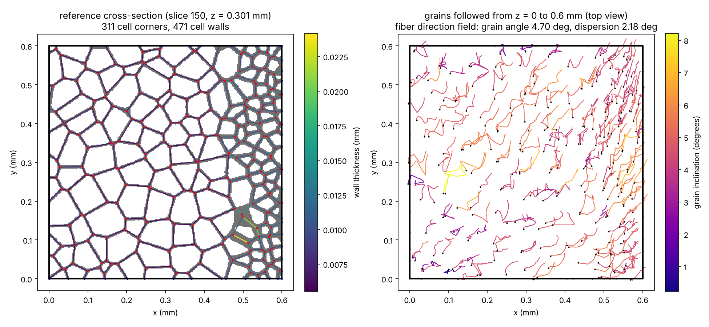

# RingsPy
[](https://www.python.org/)
[](https://badge.fury.io/py/ringspy)
[](https://anaconda.org/conda-forge/ringspy)
[](https://www.gnu.org/licenses/gpl-3.0.html)
[](https://github.com/kingyin3613/ringspy/actions/workflows/tests.yml)
[](https://codecov.io/gh/kingyin3613/ringspy)
[](https://doi.org/10.21105/joss.04945)


RingsPy is a Voronoi diagrams-based geometric generation tool that generates 3D meshes and models of prismatic cellular solids with radial growth rules.

## Dependencies and Installation
RingsPy needs Python 3.10 or newer and depends on mainstream Python libraries ``numpy``, ``scipy`` and ``matplotlib``. It optionally depends on library ``hexalattice``, if a regular hexagonal lattice (e.g. honeycomb) is wanted, and on ``vtk``, if the 3D model (STL) files are also wanted.
### 1. pip install
To install RingsPy with all optional features, one may use `pip`:
```bash
pip install "ringspy[all]"
``` 
`pip install ringspy` installs the core package only; add the extras `[vtk]` (STL export), `[hex]` (`regular_hexagonal` growth rule) or `[image]` (`.tif` stacks for `ringspy reconstruct`) as needed. One may also use:
```bash
pip install "ringspy[all] @ git+https://github.com/kingyin3613/ringspy.git"
``` 
to get updates beyond the latest release. 

### 2. conda install
To install RingsPy in `conda` environments, one can also use `conda-forge` channel:
```bash
conda install -c conda-forge ringspy
``` 

### 3. Installation Check

There are some unit tests in [tests](https://github.com/kingyin3613/ringspy/tree/main/tests/). One can use ``pytest`` to check whether the installation is successful by installing the test dependencies in the cloned ``ringspy`` directory and then running ``pytest`` there (generated files go to temporary folders):

```bash
pip install -e ".[test]"
pytest
```

`pytest -m "not slow"` skips the end-to-end runs of the examples and takes well under a minute.

## Getting Started (Current version: v2.1.0)
Once all required components are installed and one is ready to begin, a path forward should be established for generating the mesh. The basic steps for running/viewing a cellular mesh are listed as the following:

    1. Edit geometry and algorithm parameters in an input file
    2. Generate mesh with the command `ringspy run` (or with `ringspy.generate` in Python)
    3. Visualize 2D view using Matplotlib or 3D model in `ParaView`
    4. (Optional) Export 3D STL model for 3D editing and/or printing
    5. (Optional) Export input file for numerical simulations with software `Abaqus`
    6. (Optional) Generate many meshes at once with `ringspy batch`, and export the cell mesh as a graph for machine learning

Since v2.1.0, the same lattice can also be reconstructed from a 3D image of a real specimen (e.g. a CT scan of a wood cube at the scale of its cells) with `ringspy reconstruct`, see section 6.

### 1. Geometry and Parameters
The first step to generate a cellular geometry is selecting geometry and appropriate parameters. 

### 1.1. Geometry
An input file in [TOML](https://toml.io) format, for example [`wood_cube.toml`](https://github.com/kingyin3613/ringspy/tree/main/examples/wood_cube.toml) in the [examples](https://github.com/kingyin3613/ringspy/tree/main/examples/) directory, holds the parameters for the generation of a cubic wood specimen. The other examples there are a wood specimen with more regular cells (`wood_cube_lloyd.toml`), a softwood with a gradual earlywood-latewood transition and rings that differ (`wood_gradual.toml`), a ring-porous and a diffuse-porous hardwood with vessels and rays (`hardwood_ring_porous.toml`, `hardwood_diffuse.toml`), reaction wood with an eccentric pith and elliptical, wavy rings (`wood_eccentric.toml`), honeycombs clipped by a hexagon or a triangle (`honeycomb_hex.toml`, `honeycomb_tri.toml`), a dog-bone tensile specimen clipped by a polygon (`dogbone.toml`), and a mesh of previously saved cells (`saved_sites.toml`). Copy the one closest to the wanted geometry and edit it.

*Note: The Mesh Generation Tool accepts the pre-defined boundary geometries triangle, square and hexagon, and any simple polygon given by its vertices (`box_shape = "polygon"`); importing of CAD and/or other 3D model files will be implemented in subsequent versions.*

*Note: for greatest compatibility create the geometry using all millimeters.*

### 1.2. Parameters

By opening an input file, e.g., `examples/wood_cube.toml` in any text editor, a file format similar to what is shown below will be displayed:
```toml
geoName = "wood_cube"
path = "meshes"                 # output folder: the files go to meshes/wood_cube/

# Cell placement
radial_growth_rule = "binary"   # binary, binary_lloyd, regular_hexagonal, or a saved *_sites.npy file
iter_max = 500                  # increase this number to achieve a more regular geometry
print_interval = 500            # interval for printing progress info
seed = 2023                     # random seed; remove it for a different geometry on every run

# Radial cell growth
r_min = 0                       # inner radius of generation domain
r_max = 4                       # outer radius of generation domain
nrings = 4                      # number of rings
width_heart = 0.3               # ring width of the innermost ring (left out: 0.3*(r_max-r_min)/nrings)
width_sparse = 0.7              # ring width of rings with sparse cells (left out: 0.7*(r_max-r_min)/nrings)
width_dense = 0.3               # ring width of rings with dense cells (left out: 0.3*(r_max-r_min)/nrings)
generation_center = [0, 0]      # coordinates of generation domain center

cellsize_sparse = 0.02          # a number, or one value per ring: [0.024, 0.020, 0.022, 0.018]
cellsize_dense = 0.01
cellwallthickness_sparse = 0.006
cellwallthickness_dense = 0.010
transition = "abrupt"           # abrupt, linear or sigmoid: change from sparse to dense within a ring
transition_width = 1.0          # fraction of the sparse part of a ring over which it changes (linear, sigmoid)

# Shape of the growth rings (see wood_eccentric.toml): circles by default
ring_ellipticity = 1.0          # ratio of the long to the short axis of the rings
ring_ellipse_angle = 0.0        # direction of the long axis (radians)
ring_eccentricity = 0.0         # rings (1 + this) times wider towards ring_eccentricity_angle, (1 - this) times opposite
ring_eccentricity_angle = 0.0
ring_waviness = 0.0             # amplitude of a wavy outline (fraction of the radius)
ring_wave_order = 3             # crests around the circumference
ring_wave_phase = 0.0           # angle (radians) of the first crest

# Hardwood features (see hardwood_ring_porous.toml): vessels and rays, placed before the fibers
vessel_fraction = 0.0           # area fraction of the vessels (0: no vessels, a softwood)
vessel_size = 0.05              # width of the vessel cells
vessel_arrangement = "diffuse"  # diffuse (vessels over all rings) or ring (ring-porous: earlywood only)
vessel_zone = 0.5               # ring-porous: inner fraction of the earlywood that holds the vessels
# ray_spacing = 0.3             # spacing of the rays around the circumference (left out: no rays)
ray_width = 0.02                # width of the ray cells
ray_cell_length = 0.08          # radial length of the ray cells

# Clipping box
boundaryFlag = true
box_shape = "square"            # square, triangle, hexagon or polygon (see box_polygon)
box_center = [0, 0]             # coordinates of clipping box center
box_size = 4.0                  # side length

# Longitudinal direction
nsegments = 2                   # increase this number to achieve a smoother transition in longitudinal direction if theta is large
theta_min = 0                   # unit: radian
theta_max = 0.05                # unit: radian
z_min = 0
z_max = 4.0                     # segment_length = (z_max - z_min) / nsegments (left out: box_size)
long_connector_ratio = 0.02     # longitudinal joint length = ratio * segment_length

# Material
skeleton_density = 1.5e-9       # unit: tonne/mm3

# Mesh operations
merge_operation = true          # merge cell walls shorter than merge_tol
merge_tol = 0.01

precrackFlag = false
precrack_widths = 0.1

# Output files
stlFlag = true                  # 3D model (needs vtk: pip install "ringspy[vtk]")
inpFlag = true                  # input file for simulations
inpType = "Abaqus"
save_sites = false              # also save wood_cube_sites.npy and wood_cube_radii.npy, to reuse the cells later
graphFlag = false               # also save wood_cube-graph.npz, the cell mesh as a graph (PyTorch Geometric layout)
```

A parameter that is left out takes its default value, which is its value in `wood_cube.toml`; a misspelled parameter name is an error. Flags take `true`/`false` (the `'on'`/`'off'` strings of earlier versions also work).

- `geoName` is the geometry name, `path` is the folder where the mesh files will be generated (relative to the folder where `ringspy run` is started).
- `radial_growth_rule` is the radial growth rule for cell placement. When a file name with extension`.npy` is specified, a saved cell data file will be loaded (for v1.x, choose one of these rules: `binary`, `binary_lloyd`, `regular_hexagonal`, or a file name with extension `.npy`). The `.npy` file and its `_radii.npy` partner are looked for in the folder of the input file and its parents, or in `sites_dir` if given; `save_sites = true` saves them for a generated geometry.
- `iter_max` is the max number of iteration for randomly placing non-overlapping cell particles in the 2D toroidal cell placement region. Noticing that, larger `iter_max` leads to more centroidal Voronoi cells, for more reference, see [Wiki - Centroidal Voronoi Tessellation](https://en.wikipedia.org/wiki/Centroidal_Voronoi_tessellation/).
- `print_interval` is the print interval when every n cell particles are placed in the placement region.
- `seed` makes the random cell placement repeatable: the same seed gives the same files. Without a seed, every run gives a different geometry (the cells then come from NumPy's global random state, as in earlier versions). The seed is written to the report log.
- `r_min` and `r_max` are the upper and lower bounds of radii of toroidal cell placement regions (generation rings), `nrings` is the total number of rings.
- `width_heart`, `width_sparse`, and `width_dense`, are ring widths for innermost ring, rings with sparse cells, and rings with dense cells, respectively, which all together determine the morphology of the cellular structure.
- `generation_center` is the location of the placement region.
- `cellsize_sparse`,`cellsize_dense`, `cellwallthickness_sparse`, and `cellwallthickness_dense` are parameters for the sparse and dense cells (the earlywood and latewood of a growth ring; the innermost ring, the heart, has dense cells). Each is a single number for all rings, or a list with one value per ring, innermost first (e.g. `cellwallthickness_dense = [0.009, 0.010, 0.011, 0.012]` with `nrings = 4`), so that every ring can differ; the heart takes the dense values of the first ring.
- `transition` is how the cell size and the wall thickness change from the sparse part of a ring to its dense part: `"abrupt"` (the default: a step at the boundary, as in all earlier versions), `"linear"` or `"sigmoid"` (an S-shaped curve). With the last two, the values change from the sparse to the dense values over the outer fraction `transition_width` of the sparse part (between 0 and 1, default 1: the whole sparse part), so that the two parts of a ring join without a jump, like the gradual earlywood-latewood transition of spruce or fir; the dense part, and the step at the ring boundary back to the next sparse part, are unchanged. The cells of the `binary` and `binary_lloyd` rules follow the profile when they are placed, and the wall thickness follows it at every vertex. See [examples/wood_gradual.toml](./examples/wood_gradual.toml).
- `boundaryFlag` flag can be turned on/off for generating neat boundaries consisting of grains.
- `box_shape` is the shape of cutting box: `square`, `triangle`, `hexagon`, or `polygon`.
- `box_center`, and `box_size` are for describing the cutting box (square, triangle and hexagon).
- `box_polygon` gives the vertices `[[x1, y1], [x2, y2], ...]` of the cutting box for `box_shape = "polygon"`: any simple polygon, convex or not (e.g. a dog-bone specimen, see [examples/dogbone.toml](./examples/dogbone.toml)), with its vertices in either direction around it. Without `z_max`, the specimen is as long as the polygon's largest width; pre-cracks need `precrack_nodes`. As for the triangle, the `.inp` file gets only the set of all nodes, no node sets for the sides of the box (those are written for `box_shape = "square"`, and for a hexagon whose `geoName` contains `hydrostatic_` or `uniaxial_`). Keep `boundaryFlag = true` for a non-convex polygon: without the walls along the boundary, a part narrower than about a cell (a sharp tip, say) can give loose pieces. With `merge_operation`, a merge that would move a wall out of the polygon (across a notch narrower than `merge_tol`, say) is skipped, and the corners never move, so polygon edges shorter than `merge_tol` stay as short walls: simplify a finely digitised outline first.
- `nsegments` is the number of segments consisting the prismatic cells during the z- (longitudinal) extrusion, with `segment_length = (z_max - z_min) / nsegments`.
- `theta_min` and `theta_max` determine the twisting angles (unit: radian) of the 2D mesh around the `generation_center`, during the spiral z-extrusion.
- `z_min` and `z_max` determine the boundaries of prismatic cells in z- (longitudinal) direction.
- `long_connector_ratio` is the length of longitudinal joints, with `longitudinal joint length = ratio * segment_length`.
- `fiber_length` and `fiber_length_cov` (new in v2.1.0) make the cells end inside the specimen and the grains sequences of fibers of various lengths: without `fiber_length`, every grain is cut into the same `nsegments` segments and all longitudinal joints lie on common planes, like knife cuts through the specimen. With it, every cell is a sequence of cells whose lengths follow a lognormal distribution of mean `fiber_length` (mm) and coefficient of variation `fiber_length_cov` (default 0.3), the first crossing the bottom face at a random point of its length; where a cell ends, the grains at its corners get a fiber end (a longitudinal joint per wing), so the fibers of the grains start and end at different heights (see [examples/wood_cube_fibers.toml](./examples/wood_cube_fibers.toml)). The fiber ends lie on a grid of `2*nsegments` beam elements along the specimen (each segment of the regular extrusion is 2 elements): choose `nsegments` so that an element is a fraction of `fiber_length`. On every grid line, every cell wall gets a transverse connector between the nodes of its two grains, two of half height where a fiber of either grain ends there, as at the segment interfaces of the regular extrusion. The fibers then have various numbers of elements: in `geoNameIGA.txt`, the header gives the largest numbers of control points and elements of a patch, and each patch's knot vector (of `n + 5` knots for `n` elements, `2n + 1` control points) its own; the report log has a `FIBERS` section with the numbers of cell ends and fibers and their lengths. The same `seed` gives the same cells and fibers.
- `taper_length` and `taper_ratio` taper the cells to their ends: within `taper_length` (mm, default `0.15*fiber_length`) of an end, the corners of the cell draw in toward its center with a cosine profile, so that its cross-section shrinks to `taper_ratio` times its size (default 0.15; 1 means blunt ends) and the neighbouring cells fill the space, and the cell beginning above the end widens the same way. The walls (transverse connectors) of a tapering cell get shorter accordingly; corners on the sides of the clipping box stay on their sides.
- `skeleton_density` is the density of the skeleton (substance) material, e.g. density of wood cell walls in the wood microstructure. 
- `merge_operation` flag can be turned on/off for the merging operation, when flag is on, cell ridges that are shorter than the threshold `merge_tol` in the 2D mesh will be deleted, and their vertices will be merged respectively, the mesh will be reconstructed. This is designed for eliminating small cell ridges/walls which fall out of the resolution range of the 3D printing and for avoiding having elements with too small stable time increments in numerical simulations. 
- `precrackFlag` flag is for inserting pre-cracks, for the notched specimens. `precrack_nodes = [[x1, y1, x2, y2], ...]` gives the line segments of the cracks; when it is left out, a horizontal crack of length `0.1*box_size` through `box_center`, starting `0.12*box_size` from the left side of the box, is inserted. `precrack_widths` is the width of the cracks.
- `stlFlag` flag can be turned on/off for generating 3D STL files.
- `inpFlag` flag can be turned on/off for generating input files for numerical simulations.
- `inpType` indicates the software(s) that the mesh generation should generate input files for.
- `graphFlag` flag can be turned on/off for saving the 2D cell mesh as a graph (`geoName-graph.npz`, see section 5.2).
- `vessel_fraction`, `vessel_size`, `vessel_arrangement`, `vessel_zone`, `ray_spacing`, `ray_width` and `ray_cell_length` add the vessels and rays of a hardwood (section 1.3).
- `ring_ellipticity`, `ring_ellipse_angle`, `ring_eccentricity`, `ring_eccentricity_angle`, `ring_waviness`, `ring_wave_order` and `ring_wave_phase` shape the growth rings (section 1.4).

### 1.3. Hardwood features: vessels and rays
A hardwood (with the `binary` growth rule) gets its vessels and rays before the fibers are packed around them, so that the fibers keep clear of them and the Voronoi cells of the vessel and ray sites come out with the asked sizes:
- `vessel_fraction` is the fraction of the area that the vessels cover in the zone they are spread over; 0 (the default) places none. `vessel_size` is the width of the vessel cells (mm). With `vessel_arrangement = "diffuse"` the vessels are spread evenly over every growth ring (a diffuse-porous wood such as maple or birch); with `"ring"` they are in the inner fraction `vessel_zone` of the sparse (earlywood) part of every ring only, as the large earlywood vessels of a ring-porous wood such as oak or ash. The heart has no vessels.
- `ray_spacing` places rays, radial files of cells, about that far apart around the circumference: rays start at the edge of the heart, and new rays start in between them wherever the spacing has grown to 1.5 times `ray_spacing`, so that the spacing stays between 0.75 and 1.5 times `ray_spacing` out to the outermost ring. The ray cells are `ray_cell_length` long (radially, with a random jitter) and `ray_width` wide; where `ray_width` is smaller than the fibers around the ray, the ray cells come out about as wide as the fibers, so choose `ray_cell_length` a few times the fiber size for visibly elongated ray cells.

The cell type of every site is kept (`result.site_type`: 0 fiber, 1 vessel, 2 ray cell; `save_sites` also writes `geoName_types.npy`, which a `*_sites.npy` growth rule reads back), and the walls and vertices of the vessels and rays are labelled (`result.ridge_vessel`, `result.ridge_ray`, `result.vertex_vessel`, `result.vertex_ray`): the `.vtu` files carry the cell data `Vessel` and `Ray` next to `Ring` and `Dense`, the `.inp` file gets the element sets `VesselBeams`, `VesselTConns`, `VesselLConns` and `RayBeams`, `RayTConns`, `RayLConns` next to the ring sets (section 4.3), the graph file the node and edge features `vessel` and `ray`, and the report log a `HARDWOOD` section with the numbers of vessels, rays and ray cells placed. A wall between a vessel and a ray cell counts as a vessel wall. See [examples/hardwood_ring_porous.toml](./examples/hardwood_ring_porous.toml) and [examples/hardwood_diffuse.toml](./examples/hardwood_diffuse.toml); `fiber_length` (fibers of various lengths) works with them too.

### 1.4. Shape of the growth rings: ellipses, an eccentric pith, wavy rings
By default the ring boundaries are circles around `generation_center`, at the radii of `r_max`, `nrings` and the ring widths (with their random noise). Three parameters change their shape, which all the rings share, scaled from the generation center:
- `ring_ellipticity` (at least 1) makes the rings ellipses, the long axis as long as the ring radius and `ring_ellipticity` times the short one, in the direction `ring_ellipse_angle` (radians from the x axis).
- `ring_eccentricity` makes the rings `1 + ring_eccentricity` times wider towards `ring_eccentricity_angle` and `1 - ring_eccentricity` times wider opposite, so that the rings shift progressively off the pith, as in reaction wood (compression wood on the lower side of a leaning stem, or tension wood on its upper side).
- `ring_waviness` gives the outline `ring_wave_order` waves around the circumference, of amplitude `ring_waviness` times the radius, the first crest at `ring_wave_phase`.

The shape defines a ring coordinate (`result.ring_shape.rho(points)`, `MeshGenTools.RingShape`) that equals the ring radius on every ring boundary; the cells of the `binary` and `binary_lloyd` rules are placed in the bands of that coordinate (evenly over their area, the Lloyd perimeters and sub-rings following the shape), the vessels and rays of a hardwood follow it, and the wall thickness profile and the ring labels use it in place of the distance to the center. `result.ring_shape.boundary(result.radii[k])` gives the outline of a ring boundary for plotting, and the report log gets a `RING SHAPE` section when the rings are not circles. See [examples/wood_eccentric.toml](./examples/wood_eccentric.toml).


### 2.1. Run Mesh Generation
Open a Command Prompt or Terminal window, set the current directory to [examples](https://github.com/kingyin3613/ringspy/tree/main/examples/) or the folder of your own input file, then run the command:
```bash
ringspy run wood_cube.toml
```
(`python -m ringspy run wood_cube.toml` does the same.) The options `--seed`, `--path` and `--geoName` override the values in the file, e.g. `ringspy run wood_cube.toml --seed 7 --geoName wood_cube_7`.

Functions in `MeshGenTools` library will be called to create the initial mesh, wood cell particles following certain cell size distribution will be placed, then `Scipy.voronoi` function will be called to form the initial 2D Voronoi tessellation, additional code reforms the tesselation and generates the desired files. A successful generation will end with the line "Mesh files written to ..." in the Terminal window.

A new folder should have been created in the `.\meshes` directory with the same name as the `geoName` in `wood_cube.toml`.

The same generation can be run from Python, e.g. to loop over parameters:
```python
import ringspy

result = ringspy.generate("wood_cube.toml")                 # same as: ringspy run wood_cube.toml
for seed in range(5):
    ringspy.generate("wood_cube.toml", seed=seed, geoName=f"wood_cube_{seed}", stlFlag=False)

config = ringspy.Config(geoName="small_cube", r_max=2, box_size=1.0, seed=1)  # parameters left out: defaults
result = ringspy.generate(config)
print(result.output_dir, result.nParticles, result.porosity)
```
The `Result` also holds the clipped 2D cell mesh with its growth ring labels: `result.vertices` and `result.ridges` (the cell vertices, one beam each, and the cell walls as pairs of vertex indices), `result.vertex_ring`, `result.vertex_dense`, `result.vertex_boundary` and `result.vertex_thickness` (the growth ring of every vertex, 0 for the heart; whether it is in a dense part; whether it lies on the clipping boundary; its wall thickness), and `result.ridge_ring`, `result.ridge_dense`, `result.ridge_boundary` for the walls. Many meshes at once: section 5.1.

Each example also has a short Python script next to it, e.g. `python wood_cube.py`.

*Note: template scripts of earlier versions (e.g. `tests/test_wood_cube.py` of v1.1), which call the `MeshGenTools` functions one by one, still work. Their placement functions take an optional `rng` argument (a seed or a `numpy.random.Generator`) to make the cell placement repeatable.*

${\textbf{(New feature in version v0.4.x)}}$

The Lloyd's relaxation (a.k.a. Lloyd's algorithm) has been integrated with the mesh generation, one may use this approach by changing the following line in the input file (see [`wood_cube_lloyd.toml`](https://github.com/kingyin3613/ringspy/tree/main/examples/wood_cube_lloyd.toml)):
```toml
radial_growth_rule = "binary_lloyd"
``` 
This allows a rapid radial generation of more regular centroidal Voronoi cells from the `generation_center` (see the difference between `wood_binary` and `wood_binary_lloyd` in the preview of 2D cross-sections in section 2.2). For more detail of the algorithm, see [Wiki - Lloyd's algorithm](https://en.wikipedia.org/wiki/Lloyd's_algorithm)).


### 2.2. Check Mesh and 3D Model Files

The following files should be generated in the `.\meshes\geoName` directory with a successful run:
- Log file
    - Log file for model generation: `wood_cube-report.log`
- Mesh files
    - Non-Uniform Rational B-Splines (NURBS) beam file: `wood_cubeIGA.txt`
    - connector data file: `wood_cube-mesh.txt`
    - Grain-ridge data file: `wood_cube-vertex.mesh`
    - Ridge data file: `wood_cube-ridge.mesh`
- Visualization files
    - Cross-sectional image file for initial 2D configuration: `wood_cube.png`
    - Paraview vtk file for initial vertex configuration: `wood_cube_vertices.vtu`
    - Paraview vtk file for initial grain solid configuration: `wood_cube_beams.vtu`
    - Paraview vtk file of initial cell ridge configuration: `wood_cube_conns.vtu`
    - Paraview vtk file of initial connector (volume) configuration: `wood_cube_conns_vol.vtu`
    - The `.vtu` files are written as text. For large models, `rpgen.VisualizationFiles(..., vtk_format='binary')` writes them as binary files instead, which are faster to write and read and about 3 times smaller.
- (Optional) 3D model files
    - Binary STL file of initial cellular solid configuration: `wood_cube.stl`
- (Optional) Abaqus input files
    - INP file of simulation input of initial cellular solid configuration in `Abaqus`: `wood_cube.inp`
- (Optional) Graph file
    - The 2D cell mesh as a graph, in the layout of PyTorch Geometric: `wood_cube-graph.npz` (`graphFlag = true`, see section 5.2)

The growth ring of every cell is written to the files: the `.vtu` files carry the cell data `Ring` (0 for the heart, then 1, 2, ...) and `Dense` (1 in the heart and in the dense part of a ring, 0 in the sparse part), the `.inp` file has an element set per ring (section 4.3), and the report log lists the radii of the rings. A hardwood's files also carry `Vessel` and `Ray` (section 1.3). A beam and the wing quads around it take the ring of their vertex; a cell wall (and its transverse connectors) takes the ring of the vertex whose thickness it has, its second vertex; a longitudinal connector takes the ring of the wall of its wing, whose width it has. So the ring labels of the connectors always go with their `Connector_width`.


	
### 3. Visualization
A scientific visualization application `ParaView` can directly visualize the generated vtk files; It can also visualize generated 3D model STL files if the STL flag is on. `Paraview` is a free software, it can be downloaded from its official website: [https://www.paraview.org/download/](https://www.paraview.org/download/), latest version is recommeded.

### 3.1. Visualize Components of the 3D Model in ParaView
    1. Open ParaView
    2. Recommeded to temporarily turn off ray tracing
        - Uncheck "Enable Ray Tracing" (bottom left)
    3. Open File Sets in `.\meshes\geoName`
        - File > Open...
    4. Select the visualization files containing: `_vertices.vtu`, `_beams.vtu`, `_conns.vtu`
    5. Apply to visualize
        - Press Apply (left side, center)
    6. Turn on color plotting
        - Left click `_conns.vtu`, then select coloring (mid/lower left) > Connector_width
        - Or color by `Ring` (the growth ring of every beam and connector) or `Dense` (dense/sparse rings)
    7. Scale and position the image as desired
    8. Turn back on Ray Tracing
    9. Adjust Ray Tracing lighting and settings as desired
    10. Export Image
        - File > Save Screenshot
        - Enter a file name > OK
        - Leave new window as-is or increase resolution > OK

### 3.2. Visualize Volumes of the 3D Model in ParaView
    1. Open Paraview
    2. Recommeded to temporarily turn off ray tracing
        - Uncheck "Enable Ray Tracing" (bottom left)
    3. Open File Sets in `.\meshes\geoName`
        - File > Open...
    4. Select the newly created visualization files containing: `_conns_vol.vtu`
    5. Apply to visualize
        - Press Apply (left side, center)
    6. Turn on color plotting
        - Left click `_conns_vol.vtu`, then select coloring (mid/lower left) > Connector_width
    7. Scale and position the image as desired
    8. Turn back on Ray Tracing
    9. Adjust Ray Tracing lighting and settings as desired
    10. Export Image
        - File > Save Screenshot
        - Enter a file name > OK
        - Leave new window as-is or increase resolution > OK


### 4. (Optional) Numerical Simulation
The mesh generation tool can also prepare the input files for the numerical simulations of the cellular solid in other softwares. By now (version 1.x), the input file format, `.inp`, that is used in a finite element method (FEM) software `Abaqus` is supported, if the INP flag is on. `Abaqus` is a commerical software suite for integrated computer-aided engineering (CAE) and finite element analysis, own by `Dassault Systèmes`. One may refer to its [Wiki](https://en.wikipedia.org/wiki/Abaqus) for more about `Abaqus`, and to [Introduction](https://bertoldi.seas.harvard.edu/files/bertoldi/files/abaqusinputfilemanualv1.pdf?m=1444417191) for the introduction of Abaqus input files.

All steps for the model setup can be accomplished through manually coding the Abaqus input file in a text editor. The method used in the example procedure shown below requires access to the Abaqus GUI.

### 4.1 Create New Model
    1. Open Abaqus CAE
    2. Create a new model
        -	File > New Model Database > With Standard/Explicit Model

### 4.2 Import Meshed Part

    1. Import the meshed part
        - File > Import > Part
        - Select the newly created file which ends in `.inp` (note: you may need to change the File Filter to see this file)
        - Click OK
    2. Rename part
        - Under the model tree (left) expand `Parts`
        - Right click on the part > Rename...
        - Enter a new name less than 14 characters, no special symbols, and easily recognizable (i.e. "WoodCube")

*Note: if FEM parts will be added to the model, this RingsPy generated part must come first alphabetically. Also recommended not to include numbers in the name.*


### 4.3 One Material per Growth Ring
The `.inp` file defines, inside the instance, an element set for the beams, the transverse connectors and the longitudinal connectors of every growth ring: `Ring0Beams`, `Ring0TConns`, `Ring0LConns` for the heart, `Ring1Beams`, `Ring1TConns`, `Ring1LConns` for the first ring, and so on (only non-empty sets are written; `Ring5...` with `nrings = 4` holds the few elements beyond the outermost ring radius). `SparseBeams`, `SparseTConns`, `SparseLConns` and `DenseBeams`, `DenseTConns`, `DenseLConns` collect the elements of all sparse (earlywood) and all dense (latewood, and the heart) rings. In Abaqus CAE they appear as sets of the imported part, so a section with its own material can be assigned to every ring. To do the same in the input file, replace the `*Beam Section` of `AllBeams` and the `*Solid Section` lines of `AllBotConns`, `AllRegConns`, `AllTopConns` and `AllLongConns` by one section per ring set (an element must belong to one section only), for instance:
```
*Solid Section, elset=Ring1TConns, material=Earlywood
 2.5000E-03
*Solid Section, elset=Ring2TConns, material=Latewood
 2.5000E-03
```
The transverse connectors of a ring set have the wall thickness of that ring (the `width` column of `geoName-mesh.txt`), the longitudinal connectors the thickness of the wall of their wing.

### 5. (Optional) Batch Generation and Graph Export
Both are made for parameter studies and for building data sets, e.g. to train a graph neural network surrogate of the lattice model.

### 5.1 Many Meshes at Once
`ringspy batch` generates one mesh per combination of the swept parameter values and per random seed, and writes one table of their descriptors:
```bash
ringspy batch wood_cube.toml --seeds 0-9 --set cellsize_sparse=0.02,0.03 --set stlFlag=false --jobs 4
```
`--seeds` takes integers and ranges (`0-9` is 0 to 9), `--set NAME=V1,V2,...` the values of a parameter to sweep (TOML syntax: lists in brackets, e.g. `--set "cellwallthickness_dense=[0.01,0.01],[0.01,0.02]"`; a single value just changes the parameter in all runs), `--jobs` the number of runs in parallel, and `--path`/`--geoName` override the file. Run i is named `<geoName>_<i>` (`wood_cube_000`, `wood_cube_001`, ...) and gets the usual folder of files, with the first swept parameter varying slowest and the seeds fastest. The table `<path>/<geoName>-batch.csv` has one row per run with its seed, the swept parameters, and `nParticles`, `nvertex`, `nridge`, `nbeamElem`, `mass`, `bulk_volume`, `bulk_density` and `porosity`, plus the error message of a run that failed (the other runs are still generated; the command then exits with status 1). From Python:
```python
results = ringspy.batch("wood_cube.toml", seeds=range(10), sweep={"cellsize_sparse": [0.02, 0.03]},
                        jobs=4, stlFlag=False)        # a list of Results, None for a failed run
```

### 5.2 The Cell Mesh as a Graph
With `graphFlag = true` (or `--set graphFlag=true` in a batch), `geoName-graph.npz` holds the clipped 2D cell mesh as a graph in the layout of a [PyTorch Geometric](https://pytorch-geometric.readthedocs.io) `Data` object: the nodes are the cell vertices (the beams of the 3D model) and the edges the cell walls (the transverse connectors), each in both directions.
- `pos` (nvertex, 2): the vertex coordinates
- `x` (nvertex, 6): node features, named in `node_features`: growth ring, dense (1/0), boundary (1 on the clipping boundary), wall thickness at the vertex, degree (number of walls), distance to the generation center
- `edge_index` (2, 2*nridge) and `edge_attr` (2*nridge, 6): the edges and their features, named in `edge_features`: length, angle of the wall (radians, counter-clockwise from the x axis, from the first node of the edge to the second), thickness, growth ring, dense, boundary (1 for walls along the clipping boundary)
- `sites`, `radii`, `generation_center`: the cells and growth rings the mesh was made from; `nParticles`, `nbeamElem`, `mass`, `bulk_volume`, `bulk_density`, `porosity`: the model properties; `config`: all parameters of the run as a JSON string
```python
import numpy as np, torch
from torch_geometric.data import Data

g = np.load("meshes/wood_cube/wood_cube-graph.npz")
data = Data(x=torch.from_numpy(g["x"]).float(), edge_index=torch.from_numpy(g["edge_index"]),
            edge_attr=torch.from_numpy(g["edge_attr"]).float(), pos=torch.from_numpy(g["pos"]).float(),
            y=torch.tensor([float(g["porosity"])]))
```
The same arrays are returned by `ringspy.graph_arrays(result)` for any `Result`, and held in `result.graph` when the flag is on.

### 6. Reconstruction from a 3D Image (new in v2.1.0)

`ringspy reconstruct` builds the same lattice as the mesh generation (grains along the cell corners, transverse connectors across the cell walls, longitudinal connectors between the segments) from a 3D image of a real specimen at the scale of its cells, e.g. a micro-CT scan of a wood cube or a stack of cross-sectional images, instead of from a radial growth rule. The fibers of the specimen are expected to grow roughly in one direction, but they need not be straight, parallel, or aligned with the image axes: every cell corner is followed through the volume, so the grains lean, bend and twist as the fibers do, and every connector gets the wall thickness measured in its own layer.



### 6.1. Input
The image is a 3D array of voxels: a `.npy` or `.npz` file, a `.tif` stack (install `pip install "ringspy[image]"`), or, from Python, a `numpy` array. It is either boolean (`true` in the cell walls) or grayscale; a grayscale image is smoothed (`smooth_sigma`, in voxels) and thresholded (`threshold`; left out: [Otsu's threshold](https://en.wikipedia.org/wiki/Otsu%27s_method)), and `solid` says whether the cell walls are the bright phase (as in X-ray CT, where the walls attenuate more than the empty lumens) or the dark one. The array axis along the fibers is `longitudinal_axis`; left at `"auto"`, it is the axis along which the image changes least. The two other axes become x and y of the lattice, in their order in the array, and `voxel_size` (mm; one number, or one per array axis), `origin` and an optional `crop` (voxel index ranges `[x0, x1, y0, y1, z0, z1]`) place the specimen. The walls should be at least 2 to 3 voxels thick and the cells about 10 voxels or more across; the cells should be separated by the threshold (a wall with a hole merges two cells in that cross-section).

### 6.2. How It Works
1. The image is thresholded into cell walls and lumens. The lumens of every cross-section are labelled, and the labels are linked from slice to slice by overlap, starting from the reference cross-section (`reference_slice`) up and down, so that every cell keeps one label through the volume. The linking looks back a few slices, so a slice in which two cells touch through a hole in their wall, or a speck splits a cell, does not lose the labels. Lumens smaller than `min_cell_area` and wall specks smaller than `min_wall_area` are treated as noise.
2. In the reference cross-section, every pixel is given the label of the nearest lumen (the Voronoi-like partition of the cross-section into cells). The points of the pixel grid where 3 or more labels meet are the cell corners, each identified by the set of cells meeting there, and the boundaries between two labels are the cell walls, each as thick as twice the distance from its midline to the lumens. The sides of the cross-section count as cells too, so a wall running into a side ends at a boundary point and the corners of the image are the corners of the box, exactly as the clipping box of the mesh generation with `boundaryFlag = true`. The corners are then located to sub-pixel precision where the straight lines fitted to the midlines of their walls meet. `merge_operation` merges walls shorter than `merge_tol` (left out: 1.5 voxels), as for the generated meshes.
3. The fiber direction field of the volume is computed from its [structure tensor](https://en.wikipedia.org/wiki/Structure_tensor) (on a coarse grid, averaged over `direction_scale`, left out: two cell diameters): at every point the direction along which the image changes least, i.e. the direction of the tube-like cells. Its mean direction gives the grain angle (to the longitudinal axis), its azimuth and the dispersion of the fibers around it, all written to the report log.
4. Every cell corner is followed to the height of every layer of control points of the beams (the half-layers of the grid of `2*nsegments` quadratic beam elements): from the previous layer it is first moved along the fiber direction field, then placed at the junction of the same cells in the new cross-section (a junction sharing at least 3 of the corner's cells, within `max_jump` of the predicted position, one corner per junction). A corner whose junction is not found there, because a cell ended, a wall collapsed, or the cells were not separated in that cross-section, moves with its neighbours in the network instead (or along the fiber direction if none of its neighbours was found). The report log counts how the corners were placed. `tracking = "direction"` only moves the corners along the fiber direction field, `"straight"` extrudes the reference cross-section as the mesh generation does without twist, for comparison.
5. The fibers of the grains end where the cells of the image end (`fiber_ends = "image"`, the default): a cell whose lumen closes between two cross-sections ends there, and the grains at its corners get a fiber end (a longitudinal joint per wing) on the nearest line of the grid of `2*nsegments` beam elements, so the joints lie at different heights on different grains, as the cells do, and not on common planes. The tapering of a cell toward its end is in the followed positions of its corners, which draw in as the lumen narrows; once the lumen has closed, each of its corners is placed at the junction of its remaining cells (where the neighbours now meet), a small gap (half a wall thickness) apart from the corners that share it, so the cross-section of the ended cell collapses and the nodes stay distinct. `fiber_ends = "random"` draws cells of random length instead (`fiber_length`, `fiber_length_cov`, `seed`) and tapers them geometrically (`taper_length`, `taper_ratio`, as for the mesh generation); `"none"` cuts all grains into the same `nsegments` segments.
6. The lattice is built with the functions of the mesh generation: the quadratic NURBS beams pass through the followed positions (their middle control points are set accordingly), the transverse connectors of each grid line get the wall thicknesses measured in that cross-section (or `wall_thickness` for all), the longitudinal connectors follow the walls of their cross-section, and all the usual files are written.

### 6.3. Parameters
The input file [examples/reconstruction/wood_ct.toml](./examples/reconstruction/wood_ct.toml) lists all parameters with their defaults. Besides the parameters of the image described in 6.1 and of the steps described in 6.2:
- `geoName`, `path`, `nsegments`, `long_connector_ratio`, `skeleton_density`, `boundaryFlag`, `merge_operation`, `merge_tol`, `stlFlag`, `inpFlag` and `inpType` mean the same as for the mesh generation (section 1.2). With `boundaryFlag = false` there are no walls along the sides of the cross-section, no box corners, and no walls between two boundary points.
- `reference_slice`: the cross-section that gives the 2D mesh (its cells and walls are the topology of the whole lattice): `"middle"` (default, the shortest way to both ends), `"bottom"`, `"top"`, a slice index, or a height in mm (written with a decimal point).
- `fiber_ends`: `"image"` (default), `"random"` or `"none"`, see 6.2; `fiber_length`, `fiber_length_cov`, `taper_length`, `taper_ratio` and `seed` for `"random"`.
- `link_stride`: label only every n-th cross-section when linking the cells (faster for large volumes; the cells move little from slice to slice).
- `vtk_format`: `"ascii"` or `"binary"` Paraview files (binary files are smaller and faster for large models).
- `save_tracks`: also write `geoName-grains.npz` with the followed in-plane positions of every cell corner in every layer (`layer_vertices`), the control points of the beams, the heights `z_coord`, how each corner was placed in each layer (`status`), the reference vertices, ridges and wall thicknesses, and the fiber ends (`fiber_ends`: pairs of grain and grid line, `z_grid`: the heights of the grid lines).

A parameter left out takes its default, and the values derived from the image (threshold, longitudinal axis, merge tolerance, scales, minimum areas) are written to the report log.

### 6.4. Run a Reconstruction
```bash
cd examples/reconstruction
python wood_ct.py                   # makes a synthetic scan wood_ct.npy first, then reconstructs it
ringspy reconstruct wood_ct.toml    # reconstructs the scan named in the TOML file
```
`ringspy reconstruct` takes `--volume`, `--path` and `--geoName` to override the values in the file. From Python:
```python
import numpy as np
import ringspy

result = ringspy.reconstruct("wood_ct.toml")                        # same as: ringspy reconstruct wood_ct.toml
result = ringspy.reconstruct("scan.tif", voxel_size=0.0013, geoName="scan", nsegments=4)
result = ringspy.reconstruct(volume_array, voxel_size=[0.002, 0.002, 0.002], solid="dark", crop=[0, 500, 0, 500, 100, 600])
print(result.grain_angle, result.grain_dispersion, result.tracking_counts, result.porosity, result.image_porosity)
result.layer_vertices   # (nlayers, nvertex, 2): the followed cell corners of every layer; result.z_coord: the heights
```
`ringspy.reconstruct` returns a `ReconstructionResult` with the output folder and files, the properties of the lattice (as `Result`) and of the image (shape, threshold, porosity), the grain angle, azimuth and dispersion of the fibers, the mean and largest inclination of the grains, how the corners were placed, the followed corners, and the fiber ends and number of fibers. The output folder holds the same files as a generated mesh (section 2.2), plus `geoName-grains.npz` and a two-panel `geoName.png`: the reference cross-section with the cell corners and walls found in it (coloured by wall thickness) and the top view of the paths of the grains (coloured by inclination). The report log has sections on the image, the fibers and the placement of the corners.

### 6.5. Synthetic Scans
To try the reconstruction without a scan, or to check it against a known geometry, `ringspy.voxelize` rasterises any RingsPy geometry into a 3D image whose fibers lean, twist and wobble:
```python
cells = ringspy.load_config("wood_cube.toml").replace(r_max=2.0, nrings=3, box_size=0.6, box_center=[1.1, 0.0], z_max=0.6, iter_max=4000)
scan = ringspy.voxelize(cells, voxel_size=0.002, tilt=[0.05, 0.02], twist=0.02, wobble_amplitude=0.006,
                        wobble_wavelength=0.4, noise=0.15, blur=0.8, seed=2023)
np.save("wood_ct.npy", scan.volume)              # scan.volume: (nx, ny, nz) array, fibers along the last axis
result = ringspy.reconstruct(scan, geoName="check")   # a SyntheticVolume can be reconstructed directly
truth = scan.vertices_at(z=0.3)                  # the true cell corners at any height
```
`tilt` is the slope of the fibers (dx/dz, dy/dz), `twist` the twist angle over the height, and `wobble_amplitude`/`wobble_wavelength` a smooth random displacement field that bends the fibers; `fiber_length` (with `fiber_length_cov`, `fiber_end_offset` and `taper_length`) ends the cells at random heights, each tapering to a conical tip closed by a transverse wall and followed by a cell centered a little off; `noise` and `blur` make a CT-like grayscale image instead of a boolean one. The true cell corners at any height and the cell ends (`scan.cell_ends`) are kept for checks: in the tests, the corners found by their cells lie within a voxel of the true ones, and the cell ends inside the volume are found within a grid spacing.

### 6.6. Notes
- The topology of the lattice is that of the reference cross-section. Where a cell ends inside the volume, its corners get fiber ends and then move with their neighbours ("moved with their neighbours" in the report log) in the cross-sections where their junction no longer exists; the cell beginning above it has no corners of its own in the lattice. Choose the reference cross-section in the middle, or a shorter specimen (`crop`), if their number is large.
- The linking of the cell labels tells a cell that ends (its lumen closes: its pixels have become wall in the next cross-section) from a cell that is merged with its neighbour through a hole in the wall (its pixels now belong to another cell): the first gives a fiber end, the second is bridged. A tapered cell end that is cut into a thin sliver by the threshold can read as a cell that is split: `min_cell_area` sets the smallest lumen counted as a cell.
- A lumen that is connected to its neighbour through a resolved pit or a crack in a cross-section merges two cells there. The linking of the labels bridges a few such slices; more smoothing (`smooth_sigma`), a higher `min_wall_area`, or a segmentation done beforehand with a dedicated tool help with noisy scans.
- With `boundaryFlag = true`, the walls along the sides of the cross-section close the cells cut by the box, as for the generated meshes. They are material that is not in the image, so the porosity of the lattice is lower than the porosity of the image, which the report log gives for comparison.
- Running time grows with the number of slices (the linking of the cells) and with the number of voxels (the fiber direction field, computed on a grid of at most 3 million voxels); a 400 x 400 x 400 volume with 1200 cells takes about a minute. The cross-section networks are only extracted for the layers of control points, so `nsegments` matters little.

## Contributing
[](https://doi.org/10.21105/joss.04945)

If you make use of this code, or find it is useful for your own research , please cite the JOSS paper:
```
@article{ringspy,
    doi = {10.21105/joss.04945},
    url = {https://doi.org/10.21105/joss.04945},
    year = {2023},
    publisher = {The Open Journal},
    volume = {8},
    number = {83},
    pages = {4945},
    author = {Hao Yin and Gianluca Cusatis},
    title = {RingsPy: A Python package for Voronoi mesh generation of cellular solids with radial growth pattern},
    journal = {Journal of Open Source Software}
}
```

Contributions are always welcome!

If you wish to contribute code/algorithms to this project, or to propose a collaboration study, please send an email to haoyin2022 [at] u.northwestern.edu .
## License


Distributed under the GPL v3 license.


